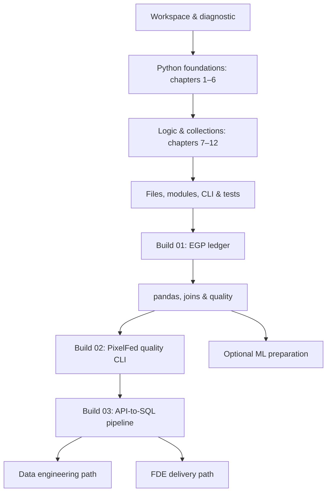

# Python Learning Roadmap

**From a first function to a reliable data pipeline.** A practical Python learning lab for Sohila Khaled Abbas, connecting existing SQL, Power BI, Power Query, n8n, and analytics-engineering experience to stronger Python foundations and reusable tools.

[Open the interactive roadmap](https://sohila-khaled-abbas.github.io/python-learning-roadmap/) · [Read the full path](docs/roadmap.md) · [12-week plan](docs/weekly-plan.md) · [Portfolio](https://sohila-khaled-abbas.vercel.app/)


## The learning system

| Layer | Purpose | How to use it |
| --- | --- | --- |
| [Boot.dev: Python for Beginners](https://www.youtube.com/watch?v=4M87qBgpafk) | Twelve timestamped chapters | Learn the concept, predict an example, then implement it yourself. |
| [ITI Python · Arabic](https://www.youtube.com/playlist?list=PLNFDrRZdysFzSkNWqHZof7NxFHtGNC6bf) | Arabic companion | Choose the relevant explanation when a concept is unclear. |
| [Harvard CS50P](https://cs50.harvard.edu/python/) / [your edX course](https://learning.edx.org/course/course-v1:HarvardX+CS50P+Python/home) | Deliberate practice | Use mapped weeks and solve the problem sets independently. |
| [Original companion notes](docs/notes/introduction.md) | Explain and connect | Forty-two notes relate Python to data, BI, API, and automation work. |
| [Original exercises](exercises/foundations.py) | Prove the foundations | Twelve tasks, one per chapter, with executable contracts and separate reference solutions. |
| [Existing DE resource collection](data/inherited-resources.csv) | Targeted enrichment | Preserves Python, pandas, NumPy, ingestion and database resources from the parent roadmap. |

The video map follows the **verified published chapter list**. Transcript export was unavailable during preparation; this is an original chapter-aligned learning guide, not a transcript-derived exhaustive summary. See [coverage, verification and attribution](docs/sources.md). ITI links are mapped at playlist level; no lesson timestamps or completion status are invented. Resources inherited from the DE catalog retain their provenance and access caveats.

## The route



**Pacing:** twelve flexible weeks with an 84-hour planning budget, roughly seven hours per week. Existing exposure is an advantage, not an automatic checkmark. Use the diagnostic to compress familiar work; repeat a stage if its exit check is not yet solid. The ML branch is optional.

## Start locally

Use an existing Python **3.11+** interpreter and Node **22+** for the website. The Python reference exercises and pipeline use only the standard library; no dependency install is needed. See the [Windows-first setup](docs/setup-windows.md), which uses the virtual environment interpreter directly and does not require activation or PowerShell policy changes.

```powershell
git clone https://github.com/Sohila-Khaled-Abbas/python-learning-roadmap.git
Set-Location python-learning-roadmap
python -m venv .venv
.\.venv\Scripts\python.exe -m scripts.check_exercises
.\.venv\Scripts\python.exe -m unittest discover -s tests -v
```

Attempt `exercises/foundations.py`, then run your own solutions:

```powershell
.\.venv\Scripts\python.exe -m scripts.check_exercises --practice
```

The practice command **fails intentionally until you implement the tasks**. CI checks the separate reference solutions; a green CI badge does not mean your personal exercises are completed.

## Three builds

| Build | Deliverable | Transfer to existing work |
| --- | --- | --- |
| [01 · EGP expense ledger](projects/01-egp-ledger.md) | Validated transactions, category totals and reconciliation | Your EGP finance-tracker domain |
| [02 · PixelFed quality CLI](projects/02-pixelfed-quality.md) | Explicit quality rules, orphan-key checks and reject report | PixelFed landing contracts and galaxy modeling |
| [03 · API-to-SQL pipeline](projects/03-api-to-sql.md) | Rerunnable loading, failure policy, exports and runbook | n8n, PostgreSQL/SQL Server and Power BI |

Build 01 and Build 02 are specifications for you to implement. Build 03 includes a working **offline CSV → validation → quarantine → SQLite → CSV reference**. Its HTTP adapter and production scheduling are explicit extensions, not completed integrations.

```powershell
.\.venv\Scripts\python.exe -m projects.pipeline
.\.venv\Scripts\python.exe -m projects.pipeline
```

Inspect `output/summary.json`, `output/rejects.csv`, `output/orders.csv` and `output/orders.sqlite`. The supplied fixture stores three distinct orders totaling **361.75 EGP**; the second run inserts zero additional rows. Identical duplicates are counted; conflicting duplicates are rejected while preserving the existing record. [Fixture provenance](data/fixtures/README.md) explains the synthetic data and expected results. This reference is a single-process teaching tool, with in-memory input and exports; it is not a production pipeline or a live currency monitor.

## Enriched learning library

The roadmap now has **42 topics and 53 resources**, including all eleven newly supplied YouTube links (one existing playlist was deduplicated). Six videos and five playlists cover Arabic/English foundations, OOP, environments, SQLite, data preparation and visualization. Every YouTube resource has a click-to-load player, including the original collection; owner restrictions still have an Open on YouTube fallback.

The original twelve-week core remains an 84-hour plan. Twelve optional depth topics add a separate 36-hour budget: OOP, generators, context managers, typing, Unicode/regex, packaging, time/money, async I/O, profiling, Parquet, database transactions and data apps. Existing topic IDs and progress keys are retained.

[Read all lessons](https://sohila-khaled-abbas.github.io/python-learning-roadmap/lessons/) · [Embedded video library](https://sohila-khaled-abbas.github.io/python-learning-roadmap/resources/) · [SEO implementation](docs/seo.md)

## Python coding lab

[Open the browser lab](https://sohila-khaled-abbas.github.io/python-learning-roadmap/lab/) to edit and run real Python with **13 original guided challenges and a free playground**. Practise EGP invoices, data validation, CSV files, API payloads, PixelFed orphan keys, SQLite, generators and an optional pandas transformation. Use progressive hints, behavioral checks, editable synthetic data, input lines, code downloads and separate lab backups.

Each lesson links to relevant practice. Drafts autosave locally; checked history records reference use and the last passing version. Topic exit checks stay under your control. A Web Worker keeps the UI responsive, with Stop and a 12-second execution limit. Python and optional pandas download on first use; there is no Python backend. [Lab guide, runtime limits and validation](docs/python-lab.md).

## Website features

- An original roadmap.sh-inspired branching map, with responsive list view.
- Forty-two topics with prerequisites, original notes, exit checks and relevant source links.
- Twelve verified core-course chapter starts, plus click-to-load previews for every YouTube video and playlist.
- ITI Arabic, CS50P and official Python/data documentation alongside the inherited resource catalog.
- Weekly deliverables and direct links to eight related repositories.
- Browser-local status and evidence notes, with validated JSON backup import/export.
- An in-browser Python editor, output console and original guided practice with checks.

Progress is private to the current browser profile and device. It is not account sync. No completion is inferred from page views. External videos and fonts load from their providers; the map works with system-font fallbacks.

## Develop and publish

```bash
npm test
python -m scripts.check_exercises
python -m unittest discover -s tests -v
npm run build
npm run check
npm run dev
```

No npm packages are required. `npm run build` regenerates `data/roadmap.json`, forty-two notes and the Markdown plans, then copies the website to `dist/`. The editorial sources are [scripts/build_curriculum.py](scripts/build_curriculum.py) and [scripts/curriculum_enrichment.py](scripts/curriculum_enrichment.py); imported resources live in [data/inherited-resources.csv](data/inherited-resources.csv). Edit those sources before rebuilding generated files.

GitHub Actions validates the contracts, prerequisite graph, chapter data, progress logic, local links and static assets, then publishes `dist/` through GitHub Pages. See [architecture and deployment](docs/architecture.md).

## Connected learning

[How the repo, portfolio and profile update automatically](docs/automation-map.md).

- [Data engineering roadmap](https://github.com/Sohila-Khaled-Abbas/data-engineering-learning-roadmap): the parent path; this repository expands its Python stage.
- [FDE roadmap](https://github.com/Sohila-Khaled-Abbas/forward-deployed-engineer-roadmap): apply Python to API contracts, SQL-backed tools and delivery.
- [PixelFed](https://github.com/Sohila-Khaled-Abbas/pixelfed-analytics-engineering): apply data contracts and quality checks.
- [n8n queue setup](https://github.com/Sohila-Khaled-Abbas/n8n-production-queue-setup): orchestrate a tested CLI in a lab environment.
- [Kickstarter](https://github.com/Sohila-Khaled-Abbas/kickstarter-analytics-engineering): reconcile Python results against Power Query at the same grain.
- [Networking labs](https://github.com/Sohila-Khaled-Abbas/udemy-networking-fundamentals) and [OS labs](https://github.com/Sohila-Khaled-Abbas/fundamentals-of-operating-systems-labs): connect code to runtime behavior.
- [Egyptian cosmetics market](https://github.com/Sohila-Khaled-Abbas/egyptian-cosmetics-market): a domain for a separately labeled synthetic commerce extension.

Original code, layout, exercises and notes are MIT-licensed. Linked course material belongs to its respective creators. This project is not affiliated with Boot.dev, ITI, Harvard, edX or roadmap.sh. No course videos, full transcripts, CS50 problem-set answers or paid materials are redistributed.
