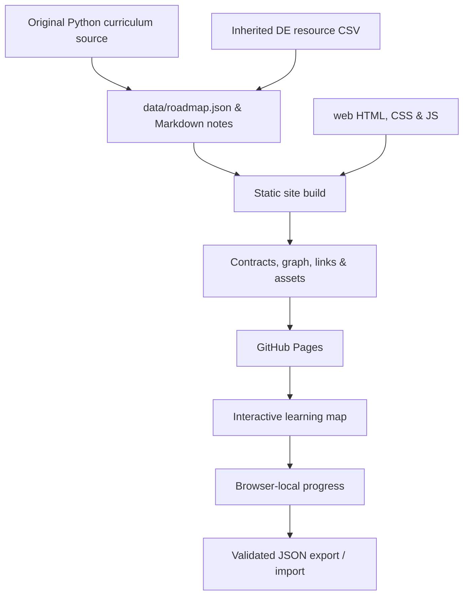

# Architecture and deployment

The project is intentionally buildless at runtime: HTML, CSS and JavaScript modules on GitHub Pages. It has no backend, secret store, paid API or user account system. The build now emits 46 crawlable HTML pages alongside the interactive map. The twelve-week core has 30 topics; twelve optional depth topics expand the complete catalog to 42.

## Source of truth

- `scripts/build_curriculum.py`: phases, original topic explanations, prerequisites, course starts, weekly tasks and source records.
- `scripts/curriculum_enrichment.py`: additional user-selected resources, deduplication, official references, twelve optional depth topics and richer explanations.
- `scripts/seo-pages.mjs`: real HTML lesson, resource and plan pages, canonical metadata, structured data and sitemap generation.
- `web/media.mjs`: shared video/playlist URL validation and click-to-load preview behavior for the map and static guides.
- `data/inherited-resources.csv`: selected records preserved from the DE learning collection.
- `web/`: original website UI. `core.mjs` holds progress validation, next-step and filtering logic; `app.mjs` binds UI events.
- `exercises/`: learner tasks, intentionally incomplete. `solutions/`: original reference solutions. CI evaluates the reference contract.
- `projects/pipeline.py`: single-process offline reference with bounded-by-fixture in-memory input. Parameterized SQLite loads, preserved rejects, precise integer currency and explicit duplicate policy.

The build writes generated notes, plans and catalog data and copies assets into ignored `dist/`. Relative asset paths support the `/python-learning-roadmap/` Pages subpath. Notes open their maintained Markdown sources on GitHub.

## Validation and release

`.github/workflows/pages.yml` runs for pushes and pull requests. Validation runs foundation contracts, pipeline failure/rerun tests, progress tests, a build, and catalog/link/asset checks. Only validated pushes to `main` deploy. Set **Settings → Pages → Source → GitHub Actions** once. The deploy job uses `pages: write` and GitHub OIDC; no stored deployment token is required.

Browser QA should additionally cover topic opening/closing, keyboard focus, chapter links, status/notes across reloads, search and filters, weekly links, import rejection and responsive layouts. Static checks alone do not prove those interactions.

## Data and progress

Progress is stored under `sohila-python-roadmap-v1` in localStorage, scoped to the Pages origin. The separate key avoids collision with the DE and FDE roadmaps. Status starts as `todo`; each record contains a status and a plain-text note. Imports validate schema, roadmap identity, known topic IDs, allowed statuses, note type/length and a one-megabyte file limit before replacing current progress. Export before replacing or clearing progress.

There is no cross-device synchronization. A browser profile reset can remove progress. Storage failures produce a visible message while retaining current session state. Notes are never rendered as HTML. This app does not transmit notes to GitHub or the portfolio.

## Portfolio connection

The portfolio’s existing public GitHub sync discovers this public repository and reads its homepage metadata. An explicit curated project record and learning-resource link provide context immediately. The existing hourly sync refreshes public source metadata while preserving editorial content. It is periodic, not an instant webhook. No new background automation or secret is necessary.

## Scope limits

The reference pipeline is a learning artifact: it does not implement network retrieval, multi-worker coordination, production retries, incremental watermarks, migrations or atomic multi-file publication. An HTTP adapter and deployment require the extra work in the Build 03 brief. None of those features are presented as completed.
